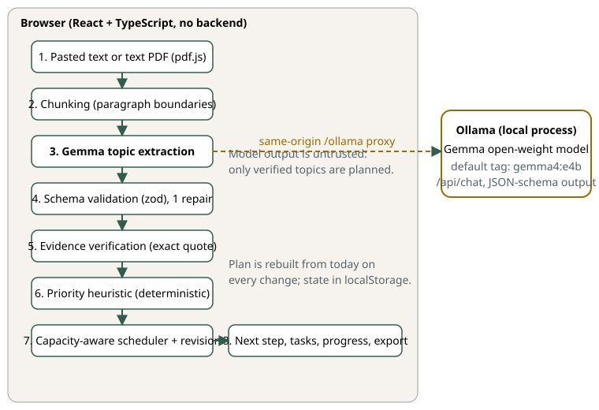
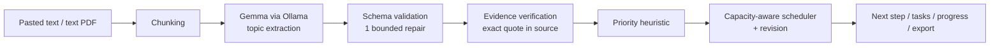

# PrepFlow Sloth

**Give it your syllabus. Get your next step.**

A study planner that lets a local open-weight model (Gemma, through Ollama) do the tedious part, reading your syllabus and finding the topics, and lets plain, tested code do the part that must be exact: prioritising, fitting work into the hours you really have, and scheduling revision.

Prepared for the [Hacktoberfest Open-Source AI Challenge, Week 3: Slow and Steady](https://dev.to/challenges/hacktoberfest-week3-2026-10-19). **Best Use of Gemma** is a candidate category; real-model use and entry are not verified.

> **Status, stated plainly.** The project includes the app, planner, evidence checks, evaluation suite (gold set, baseline, 21 fault scenarios, verifier mutation test, 2,000-scenario planner invariants), and real-Chromium check against a **mock** Ollama server. **No run against a real Gemma model is recorded.** See [docs/verification-status.md](docs/verification-status.md) and [docs/submission/evidence-checklist.md](docs/submission/evidence-checklist.md) for this checkout's latest audit results.

## The tedious work it removes

Before a student studies anything they usually: split a syllabus into topics, decide what matters, guess how long each will take, fit it around the exam date, and redo all of that every time a day goes badly. PrepFlow Sloth does that in one step, and **re-plans from today automatically**, so a missed day just slides the work forward. Nothing is ever "overdue".

## Try it without a model

Click **Try the sample (no model needed)**. It loads a short, original syllabus with hand-written topic proposals and runs them through the **real** evidence verifier, so you can see the plan, the "Why?" panels and the held-back topics. It is always labelled **SAMPLE DATA**: it is not Gemma output and says nothing about model quality. The sample contains deliberate flaws (a fabricated quote, an unrelated quote, an unsupported "high" importance) so the checks have something to catch.

**Outline mode (no AI)** extracts topics with plain rules (labelled lines, bullets, headings), also through the verifier. It is a fallback when Ollama is down and the baseline the Gemma evaluation is compared against.

## What you see

1. Paste a syllabus (or upload a text PDF), set the exam date and daily minutes.
2. Gemma proposes topics. Each must carry a quote **copied from your material**; the app checks the quote really occurs there. Topics that fail are _held back_, not planned.
3. A deterministic planner builds a schedule that fits your time. If it does not all fit, the app **says what does not fit** and what daily time would fit it.
4. Every topic and task has a **"Why?"** panel. Each line is tagged: _your material_, _you_, _model's guess_, _calculated_ or _caveat_. The model may say a topic is "high" priority only if your material says so; otherwise it is shown as medium and the panel says why.
5. The top of the page always answers: _what do I do next, why, for how long, and where in my material does it come from?_

## Architecture





The line between the two halves is the point of the design:

| Probabilistic (Gemma)                                                                                             | Deterministic (plain TypeScript, no model, no network)                                                                        |
| ----------------------------------------------------------------------------------------------------------------- | ----------------------------------------------------------------------------------------------------------------------------- |
| Reads the material, proposes topics, names prerequisites, labels effort and difficulty, writes a one-line summary | Validates model output, verifies quotes, computes minutes, priority and order, fits days, schedules revision, tracks progress |

The model never chooses a date, a duration or a priority score. Its output is untrusted: it is parsed, schema-checked, and every quote is matched against your text. Details: [docs/architecture.md](docs/architecture.md).

## Tech

React 19 + TypeScript, Vite, zod, pdf.js (in the browser), Vitest. **No backend, no database, no accounts, no API keys.** State is in your browser's `localStorage` (not synced or backed up). The browser talks to Ollama through a same-origin `/ollama` proxy that Vite provides, so no CORS configuration is needed.

## The Gemma model

Default tag: `gemma4:e4b`; `gemma4:e2b` for modest laptops; `gemma4:26b` and `gemma4:31b` are offered in the model picker (also untested here). Both are open-weight Gemma 4 models published through Ollama. Third-party guides report roughly 9.6 GB (e4b) and 7.2 GB (e2b) downloads and a 128K context window; **I have not run either model for this project**, so hardware requirements and speed on your machine are for you to measure with `npm run eval`. Check the model card for the licence terms you rely on.

## Run it

Requirements: Node 22.22.2+ (the locked jsdom test dependency requires this on Node 22), [Ollama](https://ollama.com) 0.20+ (Gemma 4 needs a recent version).

```bash
ollama pull gemma4:e4b        # one-time download (internet needed only for this)
npm ci                       # reproducible install from package-lock.json
npm run dev                   # http://localhost:5173
```

Production build served locally: `npm run build && npm start` (http://127.0.0.1:4173). To use an Ollama on another machine: `OLLAMA_URL=http://host:11434 npm run dev`.

The header shows whether Ollama is reachable and whether the chosen model is installed, with the exact command to fix it.

### Real-model checks

```bash
npm run eval:smoke                          # one sample, one run: does the plumbing work?
npm run eval -- --model gemma4:e4b --runs 3 # all 8 gold-labelled samples
```

Writes a dated JSON and a Markdown summary to `eval/results/`, recording the Ollama version, model digest, prompt hash, seed and machine, next to the rule-based baseline. There is deliberately no fake mode in `npm run eval`. Methodology and the offline results: [docs/evaluation.md](docs/evaluation.md). **No live Gemma result exists yet.**

## Tests

```bash
npm run check     # typecheck, format, 241 tests, build, external-URL scan, offline eval (exit non-zero on failure)
npm test          # tests only
npm run check:browser   # real Chromium against a mock Ollama (needs Playwright; see scripts/)
```

What the tests do and do not prove:

- **Planner** (no model, no network): capacity, exam-date boundaries, prerequisite order, session limits, revision timing, overflow, determinism, and 200 seeded random scenarios checking invariants.
- **Evidence verification**: exact-after-normalisation matching; near-misses (one changed word) are rejected, not fuzzy-matched.
- **AI pipeline**: uses a _scripted test double_, clearly not a model, to exercise malformed JSON, invalid fields, one repair, bounded retries, missing model, cancellation, duplicate merging and prompt-injection text in the material. **These tests establish that our validation behaves; they say nothing about Gemma's quality.**
- **PDF**: runs the real pdf.js against generated PDFs (valid, empty, broken, oversized, too many pages).
- **UI**: jsdom journeys (paste, analyse, next step, complete, undo, reload, overflow, failures, export). Not a visual or real-browser test.
- **Offline evaluation** (`npm run eval:offline`): scores the rule-based baseline on 8 gold-labelled materials; runs 21 fault scenarios through the pipeline with a scripted provider; checks the verifier against 1,774 synthetic quotes in 9 mutation classes; checks planner invariants over 2,000 seeded scenarios. Gold labels are one person's, written before any model run.
- **Real browser** (`npm run check:browser`, 16 checks, output in `docs/submission/browser-check-output.txt`): Chromium against the mock server `scripts/mock-ollama.mjs` (a labelled mock, **not a model**). Verifies same-origin requests only, focus, reload persistence, no horizontal overflow at 4 widths, Start over, and the Ollama-down paths.

## Privacy and offline: what is and is not claimed

- Your material goes **only** to the Ollama runtime you point the app at (by default on your own machine) and into your browser's `localStorage`. The bundle contains no analytics, CDN, font host or API URL; `npm run check:external` scans the built files for any (a _static_ check).
- A local model does not by itself make the whole app private: the Vite server, your browser extensions and an Ollama on another machine are all part of the picture. [docs/privacy.md](docs/privacy.md) separates what is verified from what you should verify (including a step-by-step offline test).
- In a real browser, the only requests made during an analysis were same-origin (`/ollama/api/tags`, `/ollama/api/chat`), and the page loads no external resource. That was observed against a mock Ollama. **Fully offline operation with a real model has not been tested.**

## Known limitations

- Quality depends on the model and your hardware; small models can miss topics, over-split or mislabel difficulty. Always read the source passage.
- "Evidence-backed" means the quote **exists in your material**. It does not mean the model's topic summary is right or that the topic will be examined.
- Estimates (minutes, difficulty) are coarse labels turned into numbers. Priority is a heuristic, not a prediction.
- Text PDFs only (no OCR). Up to 10 MB / 60 pages / 60,000 characters. Multi-column PDFs can interleave columns.
- One exam at a time. Revision uses a fixed +1/+3 day rule, not an optimised spaced-repetition model.
- Single browser, no sync. Clearing site data deletes your work (export Markdown to keep a copy).

## Provenance and attribution

This checkout has its own Git history, beginning 21 Oct 2026. It is inspired by earlier work called **PrepFlow** and shares the problem and core ideas; that relationship is documented in [docs/eligibility.md](docs/eligibility.md). The requested public destination, [piyusshhjangid/PrepFlow](https://github.com/piyusshhjangid/PrepFlow), already contains the older React/Express/Prisma/PostgreSQL project on `main`. A separate branch, [`upgrade/gemma-evidence-eval`](https://github.com/piyusshhjangid/PrepFlow/tree/upgrade/gemma-evidence-eval), preserves that history but does not make the destination repository new. The challenge requires a new project and repository within its window, so eligibility remains unresolved and needs organizer confirmation. Third-party libraries keep their own licences.

Commits made after the deadline (25 Oct 2026, 11:59 PM PDT), as the rules require: _none as of writing_. If you add any, list them here.

## Layout

```
src/core/   pure logic: dates, evidence, priority, planner, export, PDF extraction
src/ai/     provider interface, Ollama adapter, prompts, schema, analysis pipeline
src/ui/     React app, state store, styles
src/demo/   labelled sample material and hand-written proposals
eval/       samples, gold labels, metrics, faults, mutations, offline + live CLIs
scripts/    external-URL scan, mock Ollama, browser check
docs/       architecture, eligibility, category evidence, privacy, evaluation, demo script, submission drafts
```

MIT licensed.
